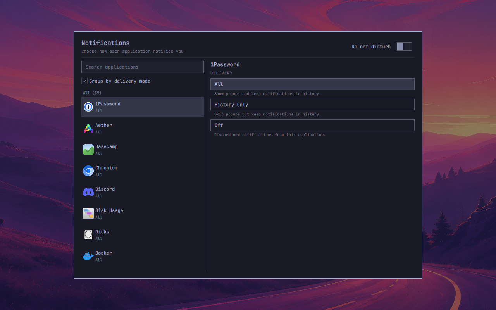

# Notification Controls

Choose how each application notifies you in Omarchy.

Notification Controls puts the apps from your application launcher in one searchable list, with their familiar names and icons. Select an app and choose how its notifications are delivered:

- **All** — show popups and keep notification history.
- **History Only** — keep notifications in history without interrupting you.
- **Off** — discard new notifications from the app.

Installed web apps have their own controls. Related background helpers follow their app's setting without cluttering the list.



## Install

Requires Omarchy's Quickshell desktop and Python 3.

```bash
omarchy plugin add https://github.com/swheel33/omarchy-notification-controls --enable
```

This replaces Omarchy's built-in notification service. To position the bell before the system tray:

```bash
omarchy bar move hotwheels.notification-controls --before omarchy.tray
```

## Open notification settings

**Left-click the bell** in the top bar to open settings. **Right-click the bell** to toggle Do Not Disturb. The bell changes to a muted icon when DND is on.

Check **Group by delivery mode** to organize applications into All, History Only, and Off sections, with a count for each group. Names stay alphabetical within each group. Search works with grouping on or off, and each application shows its current delivery mode.

Do Not Disturb silences normal notification popups across applications while retaining history.

You can also open settings with:

```bash
omarchy shell shell summon hotwheels.notification-controls
```

## Remove

```bash
omarchy plugin remove hotwheels.notification-controls
```

Removing the plugin restores Omarchy's built-in notification service. Saved notification preferences remain on disk.

## License

[MIT](LICENSE), including the original Omarchy copyright notice.
